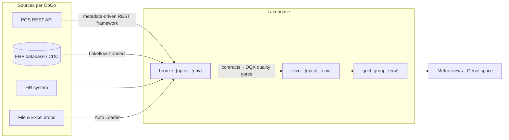

# opco-lakehouse

**A production-grade, fully documented reference implementation of a multi-OpCo Databricks lakehouse platform.**

The scenario: *Summit Retail Group*, a fictional private-equity-backed retail group, grows by acquisition.
Each acquired **operating company (OpCo)** arrives with its own systems — a different POS, a different ERP,
its own HR exports and spreadsheet habits. The group needs one governed lakehouse platform that onboards
each OpCo quickly **without pretending their source landscapes are identical**.

This repository is the whole platform, as code, plus the part reference implementations never ship:
**the architecture decisions and their trade-offs**, recorded in an [ADR register](docs/adr/).

> Status: early scaffold — the abstractions and decision records land first, the full build follows.
> See the [roadmap](#roadmap).

## The core idea: platform as deployment unit, parameterized by OpCo

An OpCo is onboarded by adding **one parameter pack** and opening a PR:

```
opcos/
├── alpina.yml     # Alpina Sports    — the established OpCo (REST POS, group ERP)
└── boreal.yml     # Boreal Outdoors  — newly acquired (file-export POS, own HR)
```

That single file drives everything downstream: Unity Catalog catalogs and grants, ingestion jobs,
pipeline instances, and CI/CD targets — all stamped from the same templates.



### Isolation is a deliberate choice on a spectrum

How isolated should one OpCo be from another? That isn't yes/no — it's a **spectrum**, from a shared
`opco` column at one end to a separate Databricks account per OpCo at the other, with schema-,
catalog-, workspace- and metastore-level boundaries in between. This platform deliberately picks
**catalog-per-OpCo** as its default point — shared account, metastore and workspace, with the
*catalog* as the boundary — enough isolation for independent blast radius and clean RBAC, without
the cost of a workspace or metastore per OpCo. The full spectrum, the trade-offs, and the triggers
for choosing a different point are in [ADR-0001](docs/adr/ADR-0001-platform-as-deployment-unit.md).
And because everything is parameter-driven, the isolation level is itself designed to be a platform
parameter: the same template could target a different point on the spectrum for a different group.

## Modules

| Module | What it demonstrates |
|---|---|
| [`docs/`](docs/) | ADR register, assumptions log, naming standards — written like a real engagement design |
| [`opcos/`](opcos/) | The OpCo parameter packs — the onboarding abstraction |
| [`simulator/`](simulator/) | Synthetic source systems with realistic imperfections (late data, schema drift, duplicates) |
| [`infra/`](infra/) | Terraform: metastore, workspaces, per-OpCo catalogs, groups & grants as code |
| [`ingestion/`](ingestion/) | Metadata-driven REST ingestion framework; Lakeflow Connect & Auto Loader configs |
| [`pipelines/`](pipelines/) | Lakeflow Declarative Pipelines: medallion, ODCS data contracts, DQX quality + quarantine |
| [`semantics/`](semantics/) | Dimensional gold, metric views, curated Genie space *(planned)* |
| [`platform-ops/`](platform-ops/) | Asset Bundles CI/CD, observability from system tables, cost monitoring |

## Two deployment profiles

| | **free** | **full** |
|---|---|---|
| Runs on | [Databricks Free Edition](https://docs.databricks.com/aws/en/getting-started/free-edition) — $0, no cloud account | Azure + Terraform |
| Scope | Ingestion → pipelines → semantics | Everything incl. account layer, networking, per-OpCo isolation |
| Purpose | Anyone can run it in an afternoon | The full platform-engineering story, applied & destroyed per demo |

Rationale in [ADR-0002](docs/adr/ADR-0002-two-deployment-profiles.md).

## Roadmap

1. **M1** — scaffold, ADR framework, source simulator, Terraform platform layer
2. **M2** — REST ingestion framework + medallion pipelines with contracts and quality gates
3. **M3** — semantic layer, Genie space, CI/CD, and the end-to-end demo: *onboarding Boreal Outdoors in one PR*

## License

Apache-2.0 — see [LICENSE](LICENSE) and [ADR-0004](docs/adr/ADR-0004-license-and-contribution.md).
