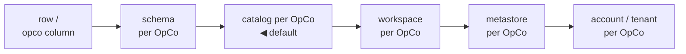
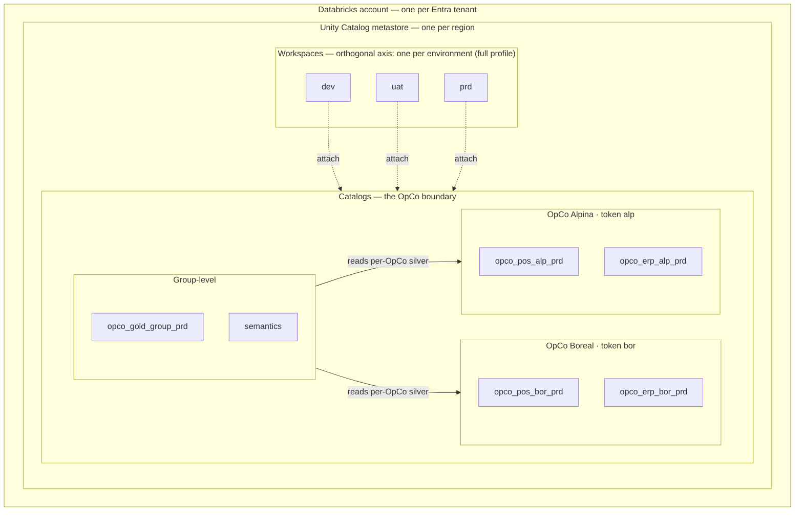
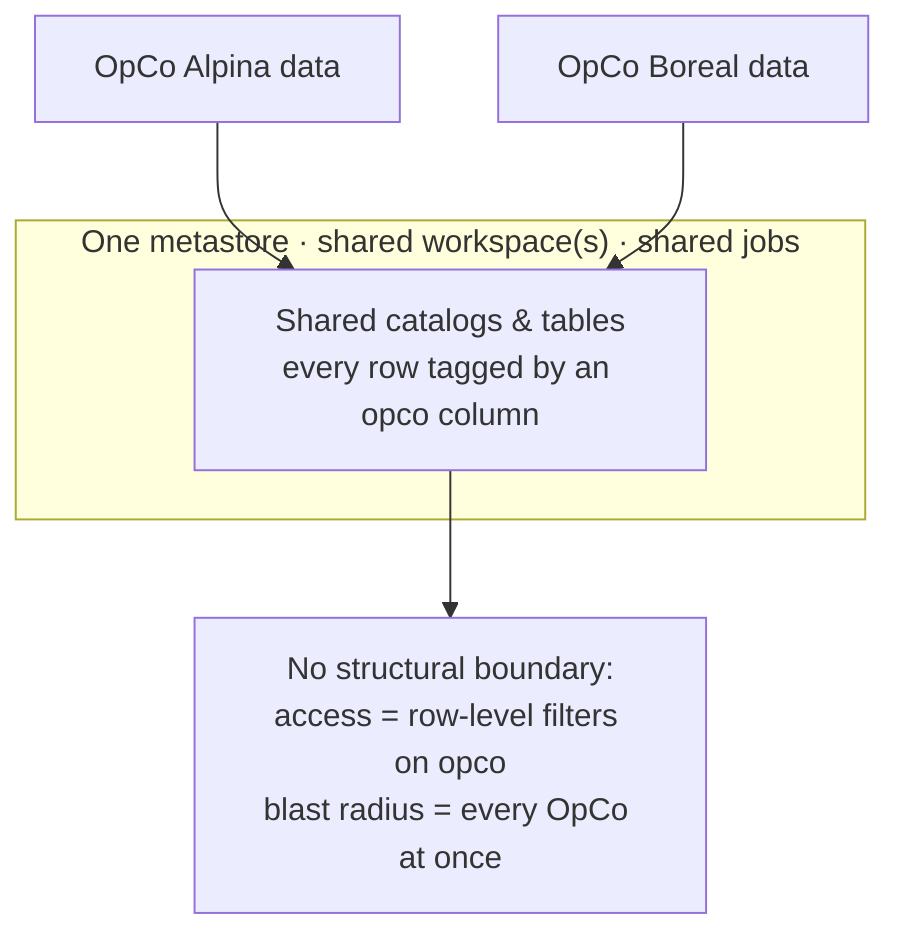
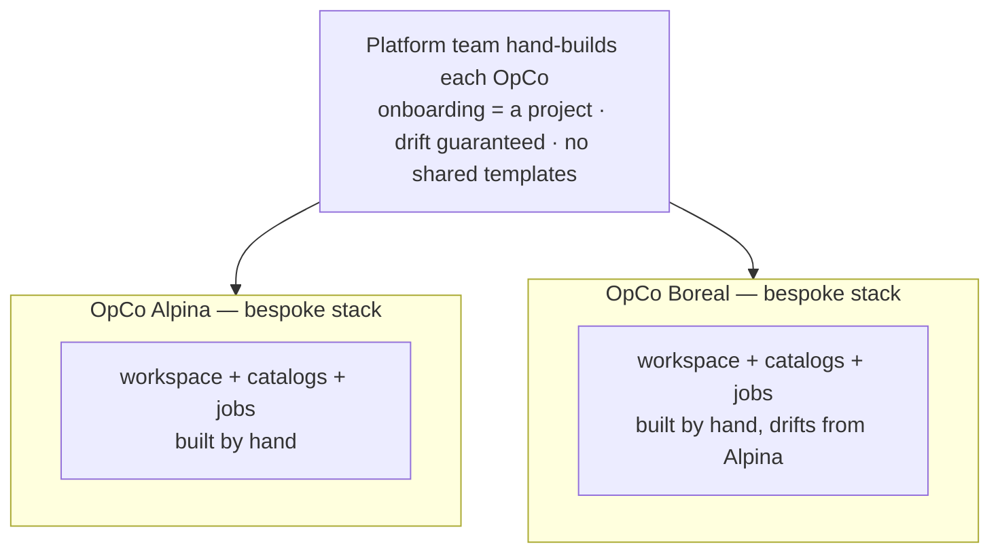
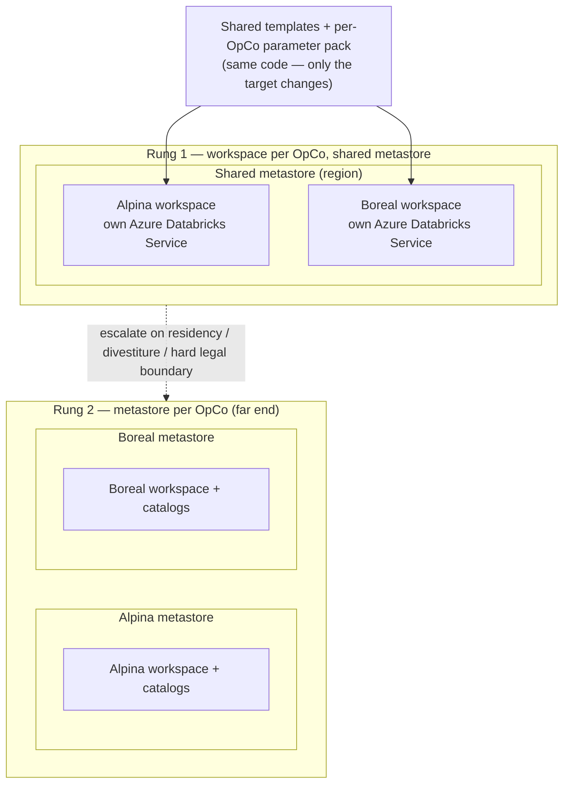

# ADR-0001: Platform as deployment unit, parameterized by OpCo

**Status:** accepted · **Date:** 2026-07-13

## Context

Summit Retail Group grows by acquisition. Each operating company (OpCo) arrives with its own
source landscape — different POS, sometimes its own ERP, different file habits — and its own
pace of integration into group standards. The group needs every OpCo on one governed lakehouse,
but the OpCos must not block each other: an onboarding experiment for a new acquisition cannot
risk the established OpCo's production pipelines.

Teams usually jump straight to one of two extremes:

1. **One shared platform, shared everything** — one set of catalogs/jobs with an `opco` column.
   Cheap to start, but blast radius is total: schema changes, backfills, and access mistakes hit
   every OpCo at once, and per-OpCo access control degenerates into row-level filters everywhere.
2. **A platform per OpCo, built by hand** — full isolation, but every onboarding is a project,
   drift between OpCo stacks is guaranteed, and the platform team becomes the bottleneck.

## The isolation spectrum — this ADR picks one point on it

Those two extremes are the **ends of a spectrum, not a binary choice**. "How isolated is one OpCo
from another?" reduces to a single question — *where do you draw the tenant boundary in the
Databricks / Azure object hierarchy?* — and every level is the right answer for some context:

| Boundary between OpCos | OpCos share… | Isolation | Typical trigger for this point |
|---|---|---|---|
| Row (`opco` column) | catalog, schema, tables | lowest | one team, low volume, fully trusted data |
| Schema per OpCo | account, metastore, workspace, catalog | low | light separation under shared governance |
| **Catalog per OpCo** ← *this platform's default* | account, metastore, workspace | **medium** | multi-OpCo, one platform team, one region |
| Workspace per OpCo | account, metastore | high | own admins / compute / cost / network isolation |
| Metastore per OpCo | account (or nothing) | higher | data residency, hard legal boundary |
| Account / tenant per OpCo | nothing | highest | divestiture, full autonomy |

*Left = more sharing, lower cost, larger blast radius. Right = more isolation, higher cost and admin
surface, smaller blast radius.*

This ADR selects **catalog-per-OpCo** as the platform's default point: enough isolation for
independent blast radius and clean per-OpCo RBAC, without paying for a workspace or metastore per
OpCo. The choice is deliberate, not assumed — and the escalation ladder under *Alternatives
considered* is exactly how a single OpCo slides one notch right when a concrete trigger (own admin
team, residency, divestiture) demands it. The neighbouring points are not wrong; they belong to
different contexts.

**Generalization — isolation level as a platform parameter.** Because the platform is stamped from
templates driven by parameter packs (the whole thesis of this ADR), the *isolation level itself* is
a candidate parameter rather than a hardcoded assumption. The same codebase could stamp
schema-per-OpCo for a small single-team group, catalog-per-OpCo (today's default) for a typical
multi-OpCo group, or workspace-/metastore-per-OpCo for a regulated multinational — choosing the
boundary level per deployment, or even per OpCo, from one platform. *Today only the catalog-level
point is implemented; treating isolation as a parameter is a stated design intent, and the
parameter-pack + templated-stamping architecture is what makes the other points a configuration
rather than a fork.*

## Decision

**The deployment unit is the OpCo platform, stamped from shared templates, driven by one
parameter pack per OpCo** (`opcos/{name}.yml`). Each OpCo gets its own catalogs
(`{domain}_{opco}_{env}`), its own service principals and Entra groups, its own storage
prefixes, its own pipeline and job instances — all generated from the same code, differing
only in parameters. Group-level products (`gold_group_{env}`, semantics) sit above and read
from the per-OpCo silver layers.

Onboarding a new OpCo = adding a parameter pack + source metadata in one PR.

### Workspace topology: the boundary is the catalog, not a workspace per OpCo

The isolation invariant is **one Databricks account and one Unity Catalog metastore per region**,
with the **catalog** as the boundary between OpCos. OpCos are *not* separated by giving each its own
workspace. The `{opco}` token differentiates catalogs, SPNs, Entra groups, storage prefixes, and
job/pipeline instances inside that shared account + metastore — it does not provision a new Azure
resource.

Terminology, stated precisely so the decision isn't misread:

- A **Databricks account** is the tenant-level container (one per Entra ID tenant); it is not a
  deployable Azure resource. Metastores and account-level identity live here.
- A **metastore** is region-scoped — one per region — and attaches to *many* workspaces; a workspace
  attaches to at most one metastore. **Catalogs** live in the metastore and are the security /
  governance boundary, reachable from attached workspaces (optionally bound to specific workspaces
  to restrict — "workspace-catalog binding").
- A **workspace** is the deployable Databricks unit that attaches to the metastore and hosts compute,
  jobs, and the UI. In Azure it is provisioned 1:1 as the resource whose portal name is **"Azure
  Databricks Service"** (ARM type `Microsoft.Databricks/workspaces`) — one Azure Databricks Service
  *is* one workspace; the two names are the same object seen from the Azure side and the Databricks
  side. We use "workspace" as the term throughout.

**Number of workspaces is an orthogonal axis — driven by environment/network, not by OpCo.** The
free profile runs a single workspace (Free Edition allows one workspace / one metastore per account).
The full Azure profile typically runs **one workspace per environment** (dev/uat/prd), all attached
to the *same* regional metastore, with env-suffixed catalogs (`opco_pos_alp_dev` vs `opco_pos_alp_prd`)
bound to their environment's workspace. In every case an OpCo remains a set of catalogs, never a workspace.

*Free profile collapses the Workspaces box to a single workspace; the account → metastore →
catalog structure is identical. Env is a catalog suffix (`opco_pos_alp_dev` vs `opco_pos_alp_prd`),
not a separate account.*

Rationale for drawing the OpCo boundary at the catalog rather than at a per-OpCo workspace:

- **Unity Catalog makes the catalog the real security and governance boundary.** Grants, lineage,
  and isolation are enforced at catalog/schema level independent of which workspace you connect from,
  so a dedicated workspace per OpCo buys little *isolation* that catalogs don't already provide —
  while multiplying infrastructure, admin surface, and drift risk.
- **Blast radius stays per-OpCo anyway**, because pipelines, jobs, SPNs, and storage prefixes are
  instanced per OpCo. A new acquisition's onboarding experiment cannot touch the established OpCo's
  production pipelines even when they share a workspace.
- **One model across both deployment profiles** (see ADR-0002): account + metastore + catalog is
  identical on free and full; only the workspace count differs (one on free, per-env on full). One
  mental model, not two.

## Consequences

- **Isolation with consistency**: per-OpCo blast radius and clean RBAC boundaries, while every
  OpCo runs identical, centrally maintained code. No drift by construction.
- **Heterogeneity is absorbed at the edges** — in the parameter pack and source metadata
  (see ADR-0003) — never in per-OpCo forks of pipeline code.
- The templates must stay honest: any "just this once" per-OpCo patch in shared code breaks the
  model. Escape hatch: OpCo-specific behavior is allowed only as declared parameters.
- More objects (catalogs, SPNs, jobs) than a shared-everything design — acceptable; objects are
  cheap, incidents are not.

## Alternatives considered

**Shared-everything** — one set of catalogs/jobs with an `opco` column (rejected: total blast
radius, and per-OpCo access control degenerates into row-level filters everywhere).

**Hand-built platform per OpCo** — full isolation, but every onboarding is a project, drift
between OpCo stacks is guaranteed, and the platform team becomes the bottleneck (rejected:
onboarding cost, drift).

**Azure Databricks Service-per-OpCo / metastore-per-OpCo — deferred, not rejected.**
Give each OpCo its own Azure Databricks Service, and — at the far end — its own Unity
Catalog metastore, instead of sharing one. This is the *chosen* pattern once specific triggers
appear, and because the platform is parameterized, adopting it is a config change (point an OpCo's
parameter pack at a different workspace / metastore), not a rewrite.

*Trigger for each rung below. Rung 1 answers admin/compute/networking isolation; Rung 2 answers
residency/legal separation. Most OpCos never leave the shared-metastore default above.*

*Escalate one OpCo to its own **Azure Databricks Service** when:*
- it needs **its own admins** or a distinct identity-provider / SSO configuration — i.e. a
  separate admin team, the ADR's original trigger;
- **compute or cost isolation** must be hard, not just tagged — separate billing, separate cluster
  policies, no noisy-neighbor risk;
- it requires **its own networking** — VNet injection, private endpoints, or an IP-access-list
  posture that differs from the group's;
- Account-level **quotas or limits** (jobs, concurrent clusters, API rate) start to bite from
  co-tenancy.

*Escalate further to its own **metastore** only when:*
- **data residency / regulatory** rules forbid the OpCo's data sharing a metastore or region
  with the rest of the group (a metastore is region-scoped, so cross-region residency alone can
  force this);
- a legal or org boundary demands that the OpCo's catalogs be **unreachable** from group
  identities even by accident — a separate metastore removes the possibility rather than
  relying on grants;
- the OpCo will be **divested** and must be cleanly separable as a unit.

Trade-off accepted by deferring: catalog-level isolation inside one shared account / metastore
suffices for every current OpCo, and each additional workspace or metastore multiplies infra cost,
admin surface, cross-workspace sharing complexity (Delta Sharing / catalog binding to reunite
group-level gold), and drift risk. We pay that price per OpCo only when a trigger above makes it
worth it — and knowing *both* the shared default and its escalation ladder, plus when each applies,
is the point.
